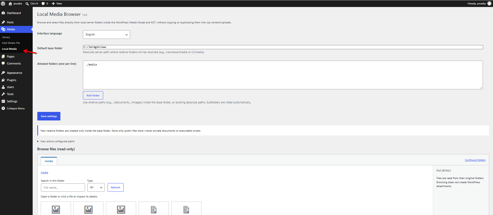
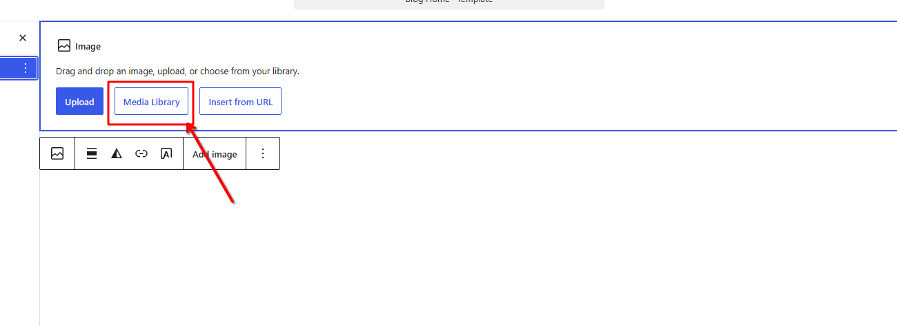
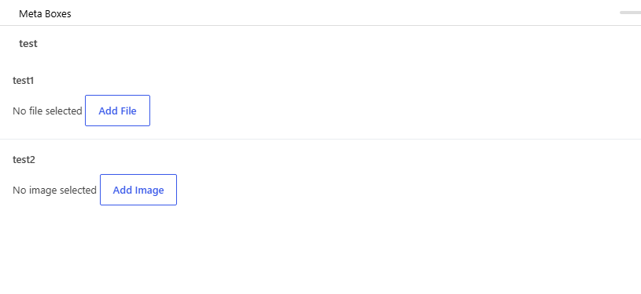
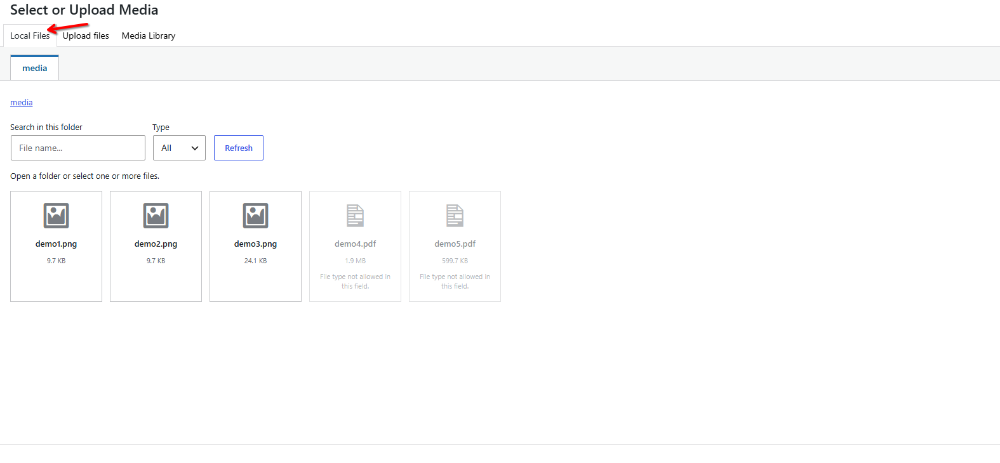
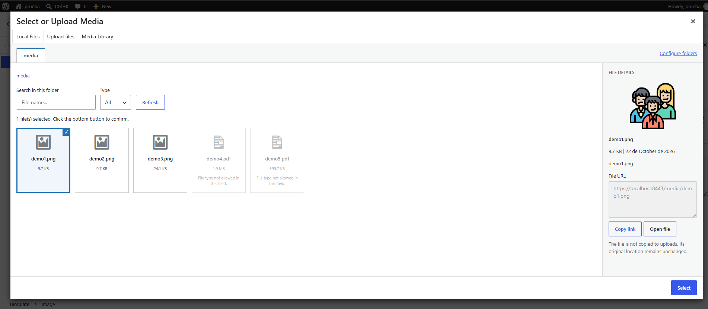

# Local Media Browser


**Local Media Browser** is a lightweight, security-focused WordPress plugin that lets you browse and select files directly from local server directories inside the **WordPress Media Library** and **Advanced Custom Fields (ACF)**—without copying, moving, or duplicating them into `wp-content/uploads`.

##  Key Features

* **Zero File Duplication:** Files remain in their original server directories. WordPress only registers a native attachment record in the database when you confirm a selection.
* **WordPress & ACF Integration:** Adds a **Local Files / Archivos locales** tab directly inside the native WordPress Media Modal, fully compatible with ACF *File*, *Image*, and *Gallery* fields.
* **Configurable Base Path:** Freely define your server's default base directory and configure relative (`./documents`, `./images`) or existing absolute paths. Completely server-agnostic (works on Apache, Nginx, LiteSpeed, etc.).
* **Built-in Multilingual UI (EN / ES):** Includes an integrated language selector in the plugin settings (*Automatic based on WordPress*, *English*, or *Español*).
* **Support for Directories Outside `ABSPATH`:** Secure read-only file streaming for folders outside the WordPress root, with HTTP `Range` support (audio/video seeking), `ETag`, and `Cache-Control` headers.
* **Original File Protection:** Deleting an attachment from the WordPress Media Library removes only the database entry—the original file on disk is strictly protected from deletion.
* **Fast Browsing Experience:** Real-time folder search, file type filters (PDF, images, audio, video), server-side pagination, and client-side directory listing cache.

##  Screenshots


### 2. Settings Panel & Built-in File Explorer


### 1. WordPress Media Modal & ACF Integration








### 3. File Details & Multi-Selection


##  Installation

### Option 1: From the WordPress Dashboard (Recommended)

1. Download `local-media-browser.zip` from the **Releases** section of this repository.
2. Go to **Plugins > Add New > Upload Plugin** in your WordPress admin panel.
3. Upload the `.zip` file, click **Install Now**, and activate the plugin.

### Option 2: Manual / FTP Installation

1. Clone or download this repository.
2. Upload the `local-media-browser` folder to `wp-content/plugins/`.
3. Activate **Local Media Browser** from the **Plugins** menu in WordPress.

##  Configuration

1. Navigate to **Media > Local Media** in the WordPress admin panel.
2. **Interface language:** Choose between automatic detection (WordPress locale), English, or Spanish.
3. **Default base folder:** Enter the absolute server path where relative folders will be resolved (e.g., `/var/www/media` or `C:/media`).
4. **Allowed folders:** Add one folder path per line:

```text
./documents
./images
/existing/absolute/path
```

* New relative paths (`./...`) are automatically created inside the base folder if they do not exist.
* Subfolders inside each configured root are discovered automatically while browsing.

5. Click **Save settings**.

##  Supported File Types

For security, the plugin enforces a strict extension whitelist while also respecting WordPress user MIME permissions:

| Category | Extensions |
| :--- | :--- |
| **Images** | `jpg`, `jpeg`, `png`, `gif`, `webp`, `avif` |
| **Audio** | `mp3`, `wav`, `ogg`, `m4a` |
| **Video** | `mp4`, `webm`, `mov` |
| **Documents** | `pdf`, `txt`, `csv`, `zip`, `doc`, `docx`, `xls`, `xlsx`, `ppt`, `pptx`, `odt`, `ods`, `odp` |

> Executable or active file formats (`php`, `js`, `html`, `svg`, etc.) are intentionally blocked by default.

##  Security

Local Media Browser is built following WordPress security best practices:

* **Path Traversal & Symlink Protection:** Every path is resolved via `realpath()`, blocking `..` segments, hidden files/directories (such as `.htaccess` or `.env`), and symlink escapes outside authorized roots.
* **System Root Guard:** Prevents accidentally setting `/` or a drive root (`C:/`) as the base folder.
* **Validated & Paginated REST API:** All endpoints enforce `upload_files` capability checks, `X-WP-Nonce` verification, input sanitization, and strict pagination limits.
* **Real Image Verification:** Validates actual image headers and MIME types before registering image attachments.
* **Concurrency Locking:** Prevents duplicate attachment creation when multiple requests select the same file simultaneously.
* **Hardened File Delivery:** Files served from outside `ABSPATH` include `X-Content-Type-Options: nosniff` and force download (`Content-Disposition: attachment`) for text and office documents.

> **Security Tip:** Only expose folders containing public media assets. Never point the plugin to directories containing private documents, backups, or application source code.

##  Technical Notes

* **Database & PHP Prefix:** `localmedia_` (options, post meta keys, locks, and actions).
* **CSS & UI Prefix:** `lm-` (scoped styles and DOM identifiers).
* **Minimal Footprint:** Self-contained 3-file architecture (`local-media-browser.php`, `assets/browser.js`, and `assets/browser.css`).

##  Requirements

* **WordPress:** 6.0 or higher
* **PHP:** 8.0 or higher
* **ACF (Optional):** Full support for *File*, *Image*, and *Gallery* fields

##  Changelog

### 1.0

* Initial public release.

##  License

This project is licensed under the **GPL-2.0-or-later** license. See the [LICENSE](https://www.gnu.org/licenses/gpl-2.0.html) file for details.